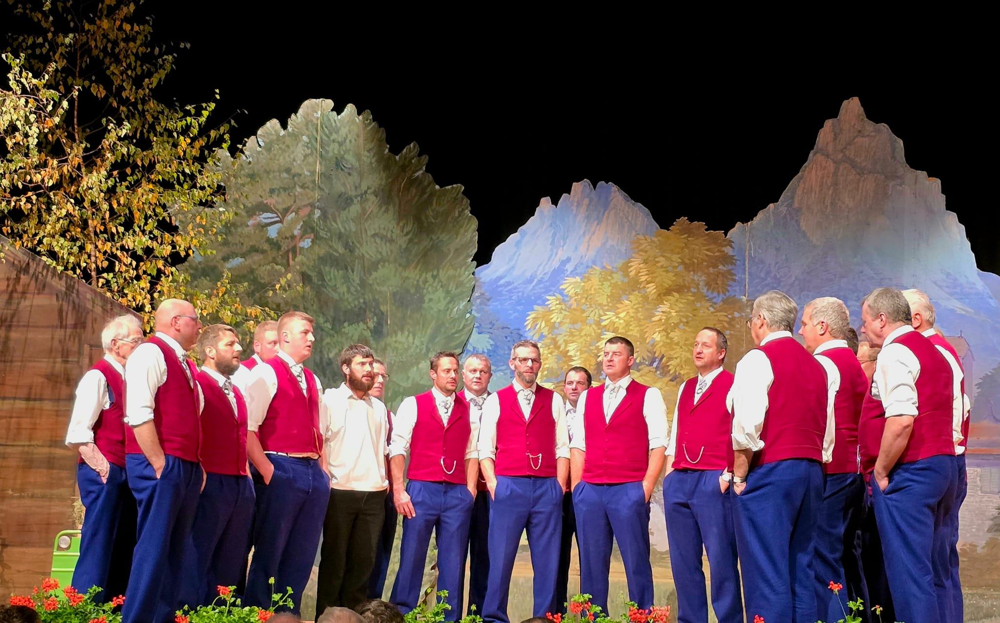

Am abwechslungsreichen Jodlerabig des Jodlerklubs Echo vom Mythen Schwyz war das Jodlerquartett Alpenrösli Heimenschwand zu Gast.

Hier geht's zum Bericht im Boten: https://www.bote.ch/nachrichten/schwyz/480-jodlerfreunde-genossen-urchige-naturjueuezli-und-schoene-jodellieder-art-1731000